# Portfolio Assistant Backoffice

**A private operational dashboard for a public, evidence-grounded assistant.**

Understand whether the assistant is available, how fresh its knowledge is, how requests
finish and what usage is estimated to cost. Google/GitHub authentication, owner-managed
access and a bilingual dashboard keep operational visibility separate from the public chat.

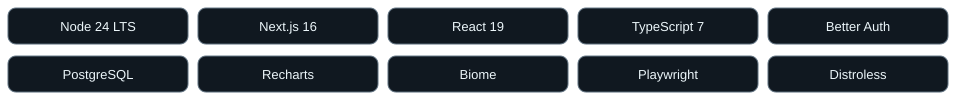

[Explore the dashboard](#the-dashboard-in-use) · [Run locally](#run-locally) · [Architecture](#architecture-and-trust-boundaries) · [Verification](#verification) · [Documentation](#documentation-map)

> **Current state:** authentication, invitations, revocation, private-API validation and
> dashboard rendering are implemented. Browser evidence uses real isolated PostgreSQL
> and clearly labeled synthetic metrics. Live OAuth-provider and production API pairing
> remain unverified. No production deployment or publication is activated here.

## What you can inspect

| Area | What it tells you |
| --- | --- |
| Availability | The latest observed API state; missing data stays unavailable instead of becoming a fabricated zero. |
| Knowledge freshness | Indexed portfolio revision, corpus version and indexing time. |
| Executions | Observed 30-day outcomes and first-token p50/p95; searchable sampled phase timings. |
| Estimated usage | UTC-month settlement/reservations, budget utilization and remaining headroom, plus reported token totals. |
| Execution stages | Allowlisted retrieval/generation timings, with no prompts, responses or visitor identifiers. |
| Access management | Verified owner admission, invited viewers, explicit account linking and live revocation. |

This is the **operations application**, not a second conversation frontend. The native
assistant belongs to the [portfolio](https://github.com/gonzalomartinperez/portfolio);
sessions, generation and measurements belong to the
[API](https://github.com/gonzalomartinperez/portfolio-assistant-api). Public repository
visibility does not make the dashboard or operational endpoints publicly accessible.

## The dashboard in use

Actual production-build captures at double pixel density. Operational values are explicitly
synthetic; PostgreSQL-backed admission and signed test sessions are real. No live OAuth
credentials, service tokens or private conversations appear in the images.

### Availability, freshness and usage at a glance

<p align="center">
  <a href="docs/assets/gallery/02-availability.png">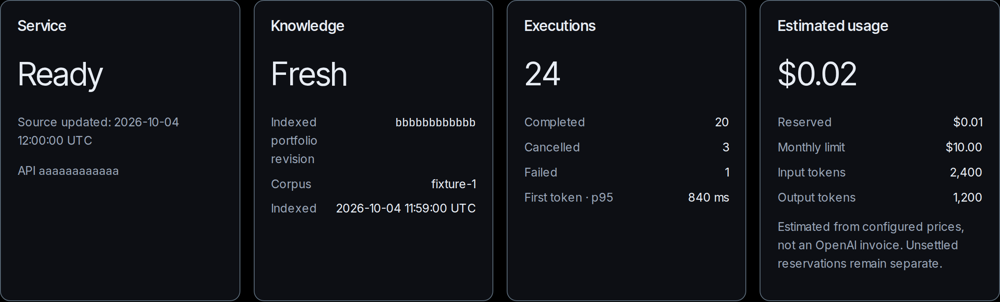</a>
</p>

### A complete operational walkthrough

Each frame focuses on an actual function. Click to open the original-resolution image.

**1 · Restricted sign-in.** Google/GitHub only; no open signup or password fallback.

<p align="center">
  <a href="docs/assets/gallery/01-sign-in.png">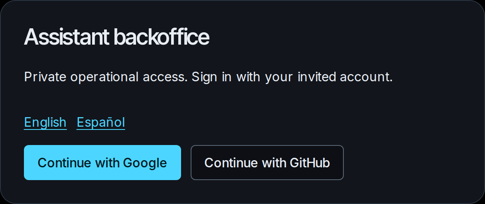</a>
</p>

<table>
  <tr>
    <td valign="top" width="50%"><strong>2 · Execution outcomes</strong><br>A selectable chart with an accessible data table.<br><a href="docs/assets/gallery/03-executions.png">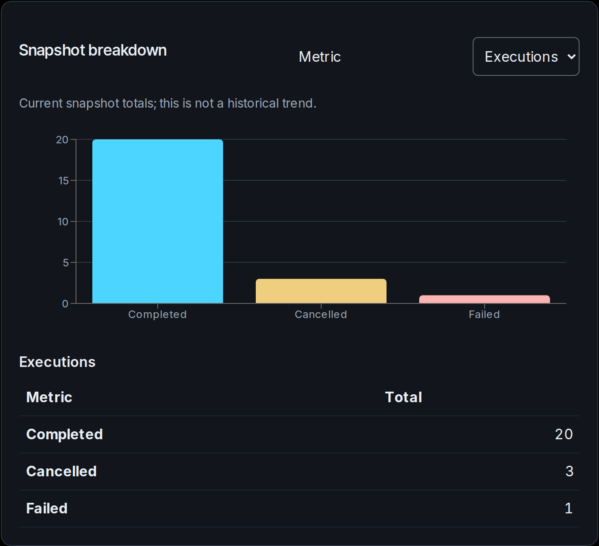</a></td>
    <td valign="top" width="50%"><strong>3 · Token breakdown</strong><br>Reported input/output totals, independent of monetary estimates.<br><a href="docs/assets/gallery/04-tokens.png">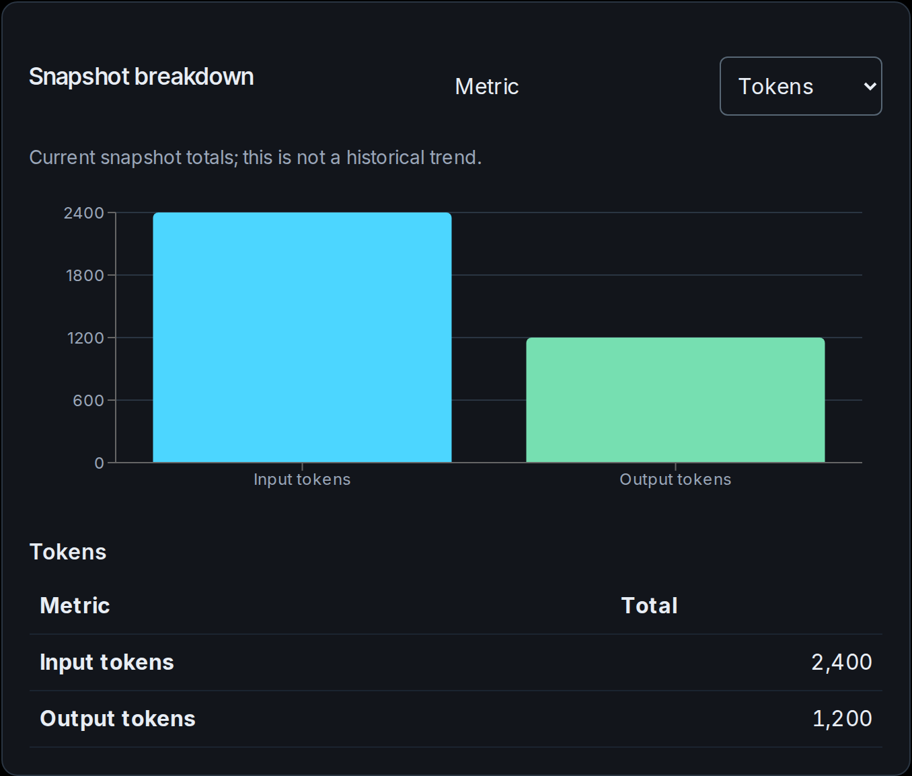</a></td>
  </tr>
</table>

**4 · Execution detail.** Filter outcomes, search an opaque trace ID and inspect relative phase timings alongside p50/p95 latency.

<p align="center">
  <a href="docs/assets/gallery/05-execution-stages.png">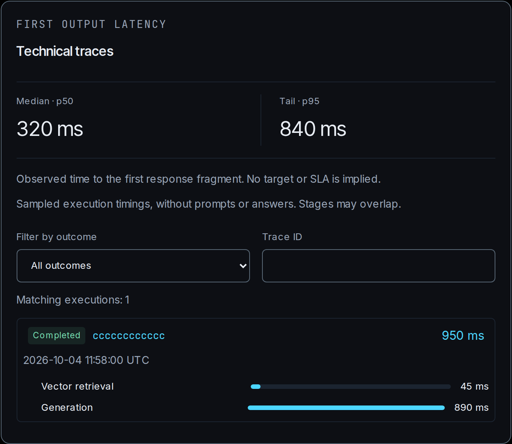</a>
</p>

<table>
  <tr>
    <td valign="top" width="50%"><strong>5 · Owner-managed access</strong><br>Invite viewers and manage membership; invitation tokens remain private.<br><a href="docs/assets/gallery/06-access.png">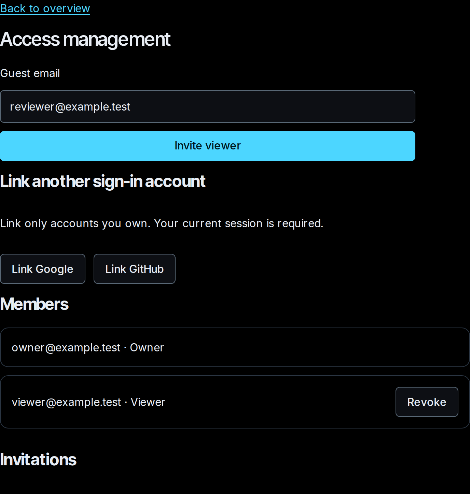</a></td>
    <td valign="top" width="50%"><strong>6 · Safe operational failure</strong><br>Clear no-data state and manual refresh, without invented measurements.<br><a href="docs/assets/gallery/07-unavailable.png">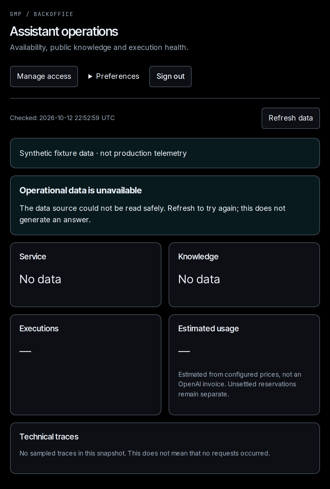</a></td>
  </tr>
</table>

<details>
<summary><strong>Spanish, light theme and mobile layout</strong></summary>

The same dashboard adapts to a narrow viewport. Theme uses one `data-theme` authority;
locale covers visible and assistive copy. Desktop chart tables remain available on mobile.

<p align="center">
  <a href="docs/assets/gallery/08-mobile-es.png">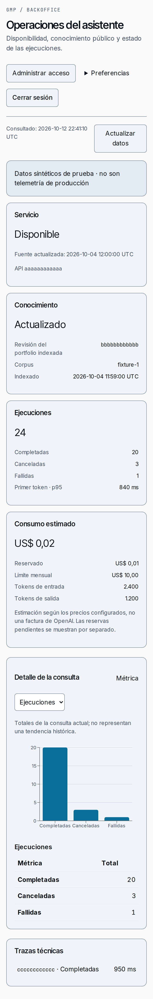</a>
</p>

</details>

[Gallery provenance](docs/verification/readme-gallery.md) records viewports, source revision,
fixture behavior and limits. [Full-dashboard captures](docs/verification/backoffice.md)
provide wider context. Emulation and automated accessibility checks do not prove
physical-device or screen-reader acceptance.

The custom dashboard complements OpenTelemetry/Prometheus/Grafana. It reads a bounded
private API summary; infrastructure monitoring stays under vps-ops. An optional approved
Grafana link requires independent access controls. No historical trends or provider uptime
are fabricated. [Design research](docs/research/operations-dashboard.md) explains the
layout and measurement choices.

## Architecture and trust boundaries

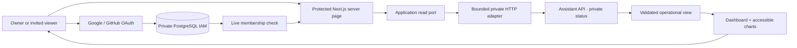

The backoffice server holds the operational read token. Browsers receive allowlisted view
data, never that token, an internal service URL or a raw backend error. Every protected
page, action and API checks current membership; hiding an action does not authorize it.

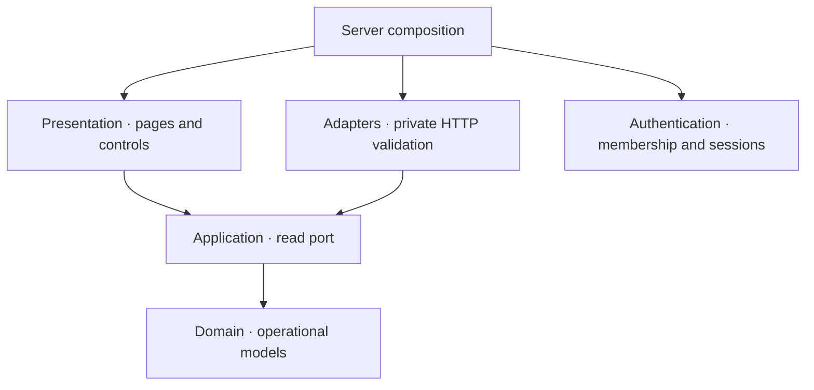

| Location | Responsibility |
| --- | --- |
| `src/features/operations/domain`, `application` | Pure models, explicit available/unconfigured/unavailable results and a small read port. |
| `src/features/operations/adapters`, `presentation` | Bounded transport, wire mapping, dashboard and intentional client controls. |
| `src/features/auth`, `migrations` | OAuth, membership, invitations, revocation and explicit IAM migration. |
| `src/components/ui`, `docs/design-system.md` | Owned primitives and portfolio-aligned tokens, variants, themes and localization. |

Architecture tests cover static, dynamic and type-only imports and server/client boundaries.
Missing metrics never silently become zero. The UI displays configured usage estimates,
not invoice totals; availability does not certify the paid model provider.

## Run locally

### With your development OAuth applications

Use Linux/WSL, Node **24.21.0** from `.nvmrc`, npm and a dedicated PostgreSQL database.

```sh
nvm use
npm ci --no-audit --no-fund
npm run contract:install
cp .env.example .env.local
```

Fill the server-only placeholders, register the exact Google/GitHub callbacks and run
migration before admitting users. Node CLI commands do not load `.env.local` automatically:

```sh
node --env-file=.env.local scripts/auth-migrate.ts
npm run dev
```

The application runs at `http://localhost:3001`. Migration is explicit; startup does not
change schema. See [authentication setup](docs/authentication.md) for owner admission,
OAuth callbacks, invitation lifecycle and safe secret handling. Password login and public
registration are disabled.

### Deterministic local preview — no provider credentials

Use a disposable database on an unused loopback port. The values below are public test
credentials, not production secrets.

```sh
docker run -d --name backoffice-readme-fixture \
  -e POSTGRES_USER=backoffice_fixture -e POSTGRES_PASSWORD=public-fixture-only \
  -e POSTGRES_DB=backoffice_test --tmpfs /var/lib/postgresql/data \
  -p 127.0.0.1:15432:5432 \
  postgres:17-bookworm@sha256:91eb910c44c7ed13f7f1a4ccadaa9ca72ef14cddc04cacb6e070e48eb44731a3

docker exec backoffice-readme-fixture pg_isready -U backoffice_fixture
npm run build
npx playwright install --with-deps chromium
npm run test:browser -- backoffice.spec.ts --project=chromium
```

Wait until PostgreSQL reports readiness. Playwright’s managed lifecycle runs migration,
provisions private signed owner/viewer sessions and starts the synthetic operations service.
It requires ports **3107**, **3108** and **8117** to be free. Add `--headed` to the test
command to watch the real flows in a local desktop environment; headless works in CI.
No external OAuth provider or model API is contacted.

`npm run preview:fixture` is an optional manual server preview. Protected pages still
require a signed fixture session, so an ordinary browser initially sees sign-in. The
[fixture procedure](docs/verification/readme-gallery.md) explains this boundary. Stop any
manual preview before running Playwright; each lifecycle owns the same isolated ports.

The browser suite starts/stops its own servers. Remove only the disposable database you
created with `docker rm -f backoffice-readme-fixture`. If 15432 is occupied, select another
port and pass `BACKOFFICE_DATABASE_URL` explicitly to the fixture/test processes. Never
point fixture reset or session tooling at shared/production databases.

### Connect private API measurements

Configure server-runtime `OPERATIONS_API_ORIGIN` and `OPERATIONS_READ_TOKEN` against the
API’s [committed private contract](https://github.com/gonzalomartinperez/portfolio-assistant-api/blob/30f2d565ce38d15f5a6e69c2323c0f3e358b3eed/docs/private-observability.md).
Omit `OPERATIONS_SOURCE_MODE` in production. No `NEXT_PUBLIC_*` service configuration is
needed. Production pairing remains a separate acceptance step.

## Verification

```sh
npm run format:check
npm run lint
npm run typecheck
npm test
npm run security:check
npm run docs:check
npm run skills:check
```

For production-image/browser acceptance, install the engines and use the isolated fixture
database described above:

```sh
npm run build
npx playwright install --with-deps chromium firefox webkit
npm run test:browser -- backoffice.spec.ts
```

`npm run test:auth` additionally exercises real PostgreSQL with a local OAuth provider;
set its fixture environment as documented in [authentication verification](docs/authentication.md#verification).
It does not contact Google/GitHub. Private session artifacts are ignored and never uploaded.

| CI job | Purpose |
| --- | --- |
| `static` | Frozen installs/audits, Biome, strict types, unit/contract/boundary checks and documentation/security/skill validation. |
| `image` | Build once and scan the complete non-root distroless runtime for HIGH/CRITICAL findings. |
| `browser` | Reuse that exact image for migration, database-backed admission, three browser engines, accessibility and termination checks. |
| `checks` | Fail closed unless every required validation job succeeds. |

The primary checker is **TypeScript 7.0.2**, including generated Next route types and strict
indexed/optional checks. The official TypeScript 6 compiler API is isolated to tooling;
the frozen OpenAPI generator uses TypeScript 5.9.3. [ADR 003](docs/adrs/003-typescript7-compatibility.md)
explains why. Node’s TypeScript execution is not a type check.

[Browser/authentication evidence](docs/verification/backoffice.md) and
[container measurements](docs/verification/container-readiness.md) distinguish fixture,
real-database and unverified production behavior. Local figures are not field performance.

## Runtime and release ownership

```sh
docker build --platform linux/amd64 -t portfolio-assistant-backoffice:local .
```

The standalone image runs as UID **65532**, exposes private port **3000**, has no shell/npm,
and supports read-only execution with bounded writable caches. `/api/health` checks the
process; `/api/ready` checks configuration and IAM schema/database readiness. Neither
proves live OAuth or operational-API availability.

Runtime environment changes require restart, not rebuilding the UI. Migration uses
`node scripts/auth-migrate.ts` in the tested image. Private **vps-ops** owns Coolify,
production composition, proxy/TLS, secret delivery, monitoring and recovery on Hostinger
KVM 4. The portfolio remains on Business and its assistant stays disabled.

Only separately authorized publication prepares an immutable image for vps-ops selection.
Main promotion never authorizes production deployment. Live OAuth registrations, effective
proxy headers, API pairing, backup/restore and physical-device behavior remain explicit gates.

## Documentation map

| Work | Start here |
| --- | --- |
| Configure accounts and invitations | [Authentication](docs/authentication.md) |
| Understand architecture and security | [Architecture](docs/architecture.md) · [Security reporting](SECURITY.md) |
| Extend the UI | [Design system](docs/design-system.md) · [Contributing](CONTRIBUTING.md) |
| Consume or refresh contracts | [API contract](docs/api-contract.md) |
| Inspect verification | [Browser evidence](docs/verification/backoffice.md) · [Gallery](docs/verification/readme-gallery.md) |
| Prepare a compatible image | [Runtime contract](docs/deployment-contract.md) · [vps-ops handoff](docs/vps-ops-optimization-handoff.md) |
| Maintain checks and dependencies | [CI](docs/ci.md) · [Dependency policy](docs/dependency-updates.md) |
| Work with agents | [Codex/Claude skills](docs/agent-skills.md) |
| Review remaining acceptance | [Checklist](docs/work-checklist.md) |

Application code retains the [MIT license](LICENSE). Fonts, identity assets and external
code retain their own [attribution and terms](THIRD_PARTY_NOTICES.md).

Shared runtime/version acceptance: [runtime baseline](docs/runtime-baseline.md).

Cross-session ownership, verified toolchain baselines and Google/Microsoft adaptations
are recorded in [engineering coordination](docs/engineering-coordination.md).
