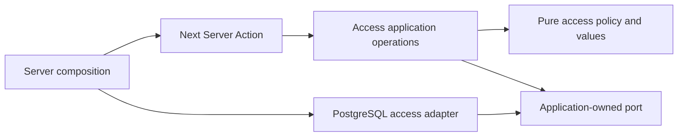

# Backoffice architecture

The root page is a protected, dynamic Server Component. Server-only
`features/operations/entry.ts` composes a bounded HTTP adapter and the application read.
Presentation receives allowlisted view data, never private URLs, tokens or diagnostics.

- `operations/domain`: pure operational models and available, unconfigured or unavailable results.
- `operations/application`: a small read port; no React, Next or concrete networking.
- `operations/adapters`: private HTTP policy, bounded UTF-8 JSON and explicit wire mapping.
- `operations/presentation`: server dashboard and intentional client preference controls.
- `auth`: OAuth configuration, PostgreSQL membership, guarded server actions and account UI.

Dependency tests inspect static, dynamic and type-only imports. Pure layers cannot depend
on frameworks/platform globals, and client components cannot import authentication
infrastructure. The native checker covers application, tooling, tests and generated routes.

Google/GitHub admission requires verified configured-owner or invited-viewer identity.
Every protected page, API and action checks live database membership; hiding a control
never authorizes an operation. IAM storage is separate from conversation data. Explicit
linking, atomic invitations and revocation are documented in [authentication](authentication.md).

Operational reads use no-store, bounded time/body, no redirects and safe failures. Missing
or rejected data stays unavailable. No model call, generation retry, transcript storage
or browser service token exists here. The [backend request](backend-operations-request.md) records the original requirements.
The API now publishes a committed private contract, linked from README; production
configuration and paired authenticated-browser verification remain separate acceptance tasks.

[ADR 004](adrs/004-native-chat-and-private-operations.md) defines ownership. The portfolio
owns one native conversation feature for compact, maximized, mobile and page presentations.
Its verified implementation is committed at `7753d39`; 31 assistant unit/network checks
and 68 browser scenarios passed before the old chat and iframe were retired here.

Former implementation source and detailed streaming architecture remain available at
[frontend baseline aed8ea7](https://github.com/gonzalomartinperez/portfolio-assistant-backoffice/tree/aed8ea710c8b847ddc9066aaef5ce48d3793b494).
Historical screenshots remain labeled. Retired chat coverage now belongs to the portfolio;
backoffice authentication, operations, dependency policy and boundary checks remain here.

## Access management without framework coupling

`auth/domain/access.ts` owns access values, revocation targets and email policy.
`auth/application/manage-access.ts` owns invitation/revocation operations and the narrow
`AccessManagementPort`. They import neither React/Next nor Better Auth, PostgreSQL,
FormData, environment variables or concrete adapters. Discriminated outcomes distinguish
success, invalid input, forbidden access and unavailable persistence.

`auth/actions.ts` is a Next transport boundary: obtain live membership, decode FormData,
call the injected operation, format the approved invitation destination and revalidate
only after success. `auth/server.ts` / `runtime.ts` compose the session and PostgreSQL
adapters. `store.ts` implements the port structurally and reauthorizes the owner inside
each write transaction. An actor snapshot or a use-case check never replaces that check.
OAuth admission, single-use invitations, audit writes and session deletion remain atomic.
The existing list/OAuth/schema adapters retain their cohesive locations; no generic
repository class, service locator or folder-only migration is introduced.

## Architectural CI contract

`npm test` runs dependency tests in the existing required static job. The AST guards
cover every feature core, static/dynamic/type-only and import-equals dependencies in `.ts`, `.tsx`, `.mts` and
`.cts`,
relative paths, cycles and transitive client-to-server imports. Explicit `use server`
modules are RPC boundaries; traversal stops there, and Next validates their exports.
The production build still enforces `server-only`. Pure application modules may not
perform direct browser/environment/network access; adapters may not import feature
presentation or entry composition. Negative fixtures exercise the actual checker.

These checks are a regression guard, not a sandbox or a substitute for authorization
and behavioral review. Computed imports in pure/presentation layers are rejected;
module-graph resolution supports this repository's relative imports and no path aliases.
Adding aliases/reexports or a new composition mechanism requires corresponding guard
coverage. Client code must never receive secrets even when its import graph is valid.
See [engineering coordination](engineering-coordination.md) for standards and ownership.

Owned source still prefers `.ts`/`.tsx` per CONTRIBUTING; the guard and primary checker
cover `.mts`/`.cts` defensively so an alternate TypeScript module suffix cannot evade CI.
